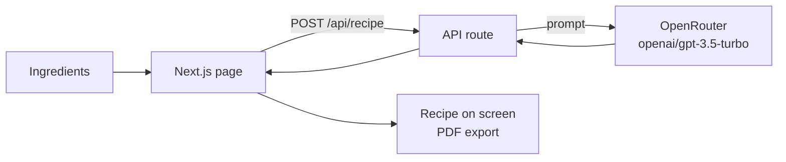

# AI Recipe Generator

Type in the ingredients you have and get a complete recipe: title, ingredient list and step-by-step instructions. Built for the Nexium assignments.

## How it works



- `app/page.tsx`: the UI, where you enter ingredients, generate the recipe and download it as a PDF (`html2pdf.js`)
- `app/api/recipe/route.ts`: server route that sends a "creative chef" prompt to OpenRouter and returns the recipe

## Run locally

```bash
pnpm install
echo "OPENROUTER_API_KEY=your_key_here" > .env.local
pnpm dev
```

Open http://localhost:3000. The API key stays on the server and is never sent to the browser.

## Stack

Next.js 15 (App Router), React 19, TypeScript, Tailwind CSS 4, OpenRouter API.
